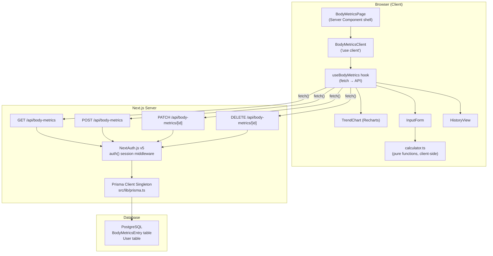
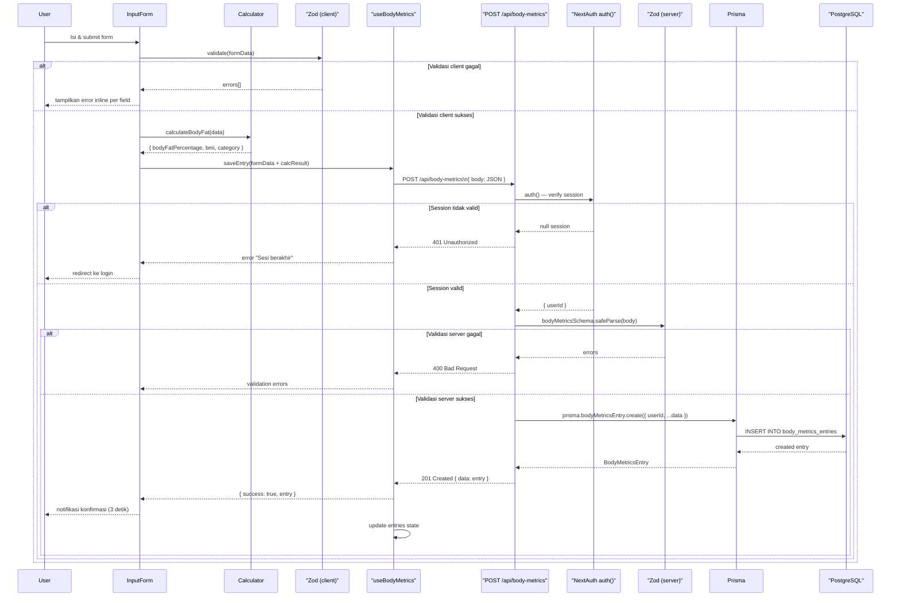

# Design Document — Body Metrics

## Overview

Fitur Body Metrics adalah modul inti aplikasi fitness monitoring yang memungkinkan pengguna melacak komposisi tubuh secara akurat dari berbagai perangkat (HP dan desktop). Karena aplikasi bersifat multi-user dan dihosting, semua data disimpan di **PostgreSQL** melalui **Prisma ORM** dan diakses melalui **Next.js Route Handlers**. Setiap entry terikat ke `userId` pengguna yang sedang login.

Modul ini terdiri dari empat sub-sistem utama: **Input Form** untuk entri data harian, **Calculator** sebagai engine kalkulasi US Navy Body Fat Formula dan BMI, **Chart** untuk visualisasi tren, dan **History View** untuk manajemen riwayat data.

Autentikasi ditangani oleh **NextAuth.js v5 (Auth.js)** dengan session berbasis database. Setiap API route memverifikasi session sebelum memproses request. Kalkulasi formula tetap berjalan sebagai pure functions di sisi klien — tidak ada kalkulasi di server.

### Keputusan Arsitektur Utama

| Keputusan | Pilihan | Rasional |
|---|---|---|
| Persistent storage | PostgreSQL + Prisma ORM | Multi-user, multi-device, data tersimpan di server |
| API layer | Next.js Route Handlers (`src/app/api/`) | Akses DB hanya dari server; tidak expose Prisma ke client |
| Autentikasi | NextAuth.js v5 (Auth.js) | Session-based, terintegrasi dengan Next.js App Router |
| Auth guard | `auth()` dari NextAuth v5 di setiap route handler | Semua endpoint dilindungi, kepemilikan diverifikasi per entry |
| Chart library | Recharts | React-native, TypeScript support baik, composable API |
| State management | React `useState` + custom hook `useBodyMetrics` | Hook memanggil `fetch()` ke API, bukan localStorage |
| Kalkulasi | Pure functions di `_lib/calculator.ts` (client-side) | Formula deterministik, tidak membutuhkan server round-trip |
| Validasi | Zod — digunakan di client (form) dan server (API route) | Single source of truth schema, mencegah invalid data masuk DB |
| Komponen Next.js | `'use client'` untuk semua komponen interaktif | Form, chart, dan state management butuh browser APIs |

---

## Architecture

### Diagram Arsitektur Keseluruhan



### Alur Data — Form Submit



---

## Components and Interfaces

### Hierarki Komponen

```
src/
├── app/
│   ├── api/
│   │   └── body-metrics/
│   │       ├── route.ts                    # GET (list), POST (create)
│   │       └── [id]/
│   │           └── route.ts                # PATCH (update), DELETE (delete)
│   └── body-metrics/
│       ├── page.tsx                        # Server Component (shell, metadata)
│       ├── loading.tsx                     # Loading skeleton
│       ├── error.tsx                       # Error boundary
│       └── _components/
│           ├── BodyMetricsClient.tsx       # 'use client' root
│           ├── InputForm/
│           │   ├── InputForm.tsx
│           │   ├── BasicInputSection.tsx
│           │   ├── CircumferenceSection.tsx
│           │   └── FormField.tsx
│           ├── TrendChart/
│           │   ├── TrendChart.tsx
│           │   ├── TimeRangeSelector.tsx
│           │   └── EmptyChartState.tsx
│           └── HistoryView/
│               ├── HistoryView.tsx
│               ├── HistoryTable.tsx
│               ├── EntryDetailModal.tsx
│               └── DeleteConfirmDialog.tsx
├── _hooks/
│   └── useBodyMetrics.ts                   # Custom hook: fetch API, state
└── _lib/
    ├── types.ts
    ├── calculator.ts
    └── validation.ts
├── lib/
│   └── prisma.ts                           # Prisma client singleton
└── prisma/
    └── schema.prisma                       # Database schema
```

### Interface Komponen Utama

```typescript
// BodyMetricsClient.tsx
interface BodyMetricsClientProps {
  // tidak ada props dari server — data di-fetch dari API
}

// InputForm.tsx
interface InputFormProps {
  onEntrySaved: (entry: BodyMetricsEntry) => void
}

// TrendChart.tsx
interface TrendChartProps {
  entries: BodyMetricsEntry[]
  timeRange: TimeRange
  onTimeRangeChange: (range: TimeRange) => void
}

// HistoryView.tsx
interface HistoryViewProps {
  entries: BodyMetricsEntry[]
  onDelete: (id: string) => Promise<void>
  onSelect: (entry: BodyMetricsEntry) => void
  isLoading: boolean
}
```

---

## Data Models

### Core TypeScript Types

```typescript
// src/app/body-metrics/_lib/types.ts

export type Gender = 'male' | 'female'

export type TimeRange = 'daily' | 'weekly' | 'monthly' | 'yearly'

/**
 * Kategori komposisi tubuh berdasarkan standar ACSM.
 */
export type BodyCompositionCategory = 'underfat' | 'normal' | 'overfat' | 'obese'

/**
 * Satu rekaman pengukuran tubuh pada satu tanggal.
 * Mencerminkan struktur baris di tabel `body_metrics_entries`.
 */
export interface BodyMetricsEntry {
  id: string                        // CUID dari Prisma
  userId: string                    // relasi ke User
  measurementDate: string           // format: YYYY-MM-DD
  height: number                    // cm, 100–250
  weight: number                    // kg, 20–300
  gender: Gender
  neckCircumference?: number        // cm
  abdomenCircumference?: number     // cm (pria)
  waistCircumference?: number       // cm (wanita)
  hipCircumference?: number         // cm (wanita)
  thighCircumference?: number       // cm (opsional)
  chestCircumference?: number       // cm (opsional)
  notes?: string                    // max 500 chars
  // Calculated fields — disimpan bersama entry untuk efisiensi display
  bodyFatPercentage?: number        // %, 2 decimal places
  bmi?: number                      // 2 decimal places
  bodyCompositionCategory?: BodyCompositionCategory
  createdAt: string                 // ISO 8601 timestamp
  updatedAt: string                 // ISO 8601 timestamp
}

/**
 * Hasil kalkulasi dari Calculator module.
 */
export interface CalculationResult {
  bodyFatPercentage: number
  bmi?: number
  category: BodyCompositionCategory
}

/**
 * Error dari Calculator module.
 */
export interface CalculationError {
  type: 'INVALID_INPUT' | 'INVALID_GEOMETRY' | 'MISSING_REQUIRED_FIELD'
  message: string
  field?: keyof BodyMetricsEntry
}

export type CalculationOutput =
  | { success: true; result: CalculationResult }
  | { success: false; error: CalculationError }

/**
 * Generic API response wrapper.
 * Semua route handlers mengembalikan tipe ini sebagai JSON.
 */
export type ApiResponse<T> =
  | { success: true; data: T }
  | { success: false; error: string; fieldErrors?: Record<string, string[]> }

/**
 * State yang dikelola oleh useBodyMetrics hook.
 */
export interface BodyMetricsState {
  entries: BodyMetricsEntry[]
  isLoading: boolean
  error: string | null
}

/**
 * Data form sebelum kalkulasi dan pengiriman ke API.
 */
export interface BodyMetricsFormData {
  measurementDate: string
  height: string          // string di form, di-parse ke number saat submit
  weight: string
  gender: Gender | ''
  neckCircumference: string
  abdomenCircumference: string
  waistCircumference: string
  hipCircumference: string
  thighCircumference: string
  chestCircumference: string
  notes: string
}

/**
 * Payload yang dikirim ke POST /api/body-metrics
 */
export interface CreateEntryPayload {
  measurementDate: string
  height: number
  weight: number
  gender: Gender
  neckCircumference?: number
  abdomenCircumference?: number
  waistCircumference?: number
  hipCircumference?: number
  thighCircumference?: number
  chestCircumference?: number
  notes?: string
  bodyFatPercentage?: number
  bmi?: number
  bodyCompositionCategory?: BodyCompositionCategory
}
```

### Prisma Schema

```prisma
// prisma/schema.prisma

generator client {
  provider = "prisma-client-js"
}

datasource db {
  provider = "postgresql"
  url      = env("DATABASE_URL")
}

model User {
  id             String               @id @default(cuid())
  email          String               @unique
  name           String?
  hashedPassword String?
  createdAt      DateTime             @default(now())
  updatedAt      DateTime             @updatedAt
  bodyMetrics    BodyMetricsEntry[]

  @@map("users")
}

model BodyMetricsEntry {
  id                     String    @id @default(cuid())
  userId                 String
  measurementDate        DateTime  @db.Date
  height                 Float
  weight                 Float
  gender                 String    // 'male' | 'female'
  neckCircumference      Float?
  abdomenCircumference   Float?
  waistCircumference     Float?
  hipCircumference       Float?
  thighCircumference     Float?
  chestCircumference     Float?
  notes                  String?   @db.VarChar(500)
  bodyFatPercentage      Float?
  bmi                    Float?
  bodyCompositionCategory String?  // 'underfat' | 'normal' | 'overfat' | 'obese'
  createdAt              DateTime  @default(now())
  updatedAt              DateTime  @updatedAt

  user User @relation(fields: [userId], references: [id], onDelete: Cascade)

  // Unique constraint: satu user tidak boleh punya dua entry pada hari yang sama
  @@unique([userId, measurementDate])
  // Index untuk query umum: ambil semua entry milik user, diurutkan
  @@index([userId, measurementDate(sort: Desc)])

  @@map("body_metrics_entries")
}
```

### Prisma Client Singleton

```typescript
// src/lib/prisma.ts
import { PrismaClient } from '@prisma/client'

const globalForPrisma = globalThis as unknown as {
  prisma: PrismaClient | undefined
}

export const prisma =
  globalForPrisma.prisma ??
  new PrismaClient({
    log: process.env.NODE_ENV === 'development' ? ['query', 'error', 'warn'] : ['error'],
  })

if (process.env.NODE_ENV !== 'production') {
  globalForPrisma.prisma = prisma
}
```

---

## API Routes

Semua route berada di `src/app/api/body-metrics/`. Setiap handler:

1. Memanggil `auth()` dari NextAuth v5 untuk mendapatkan session
2. Mengembalikan `401` jika session tidak ada
3. Memvalidasi input dengan Zod
4. Memverifikasi kepemilikan entry (untuk PATCH dan DELETE)
5. Mengembalikan `ApiResponse<T>` sebagai JSON

### `GET /api/body-metrics`

Mengambil semua entry milik user yang sedang login.

**Query params opsional:**
- `from` — tanggal mulai (format: `YYYY-MM-DD`)
- `to` — tanggal akhir (format: `YYYY-MM-DD`)

**Responses:**
- `200 OK` — `ApiResponse<BodyMetricsEntry[]>`
- `401 Unauthorized` — session tidak ada atau kadaluarsa
- `500 Internal Server Error` — database error

```typescript
// src/app/api/body-metrics/route.ts (GET)
export async function GET(request: NextRequest) {
  const session = await auth()
  if (!session?.user?.id) {
    return NextResponse.json({ success: false, error: 'Unauthorized' }, { status: 401 })
  }

  const { searchParams } = request.nextUrl
  const from = searchParams.get('from')
  const to = searchParams.get('to')

  try {
    const entries = await prisma.bodyMetricsEntry.findMany({
      where: {
        userId: session.user.id,
        ...(from || to ? {
          measurementDate: {
            ...(from ? { gte: new Date(from) } : {}),
            ...(to ? { lte: new Date(to) } : {}),
          }
        } : {}),
      },
      orderBy: { measurementDate: 'desc' },
    })
    return NextResponse.json({ success: true, data: entries })
  } catch {
    return NextResponse.json({ success: false, error: 'Database error' }, { status: 500 })
  }
}
```

### `POST /api/body-metrics`

Membuat entry baru.

**Request body:** `CreateEntryPayload` (JSON)

**Responses:**
- `201 Created` — `ApiResponse<BodyMetricsEntry>`
- `400 Bad Request` — validasi Zod gagal, atau duplikasi tanggal
- `401 Unauthorized`
- `500 Internal Server Error`

```typescript
// src/app/api/body-metrics/route.ts (POST)
export async function POST(request: NextRequest) {
  const session = await auth()
  if (!session?.user?.id) {
    return NextResponse.json({ success: false, error: 'Unauthorized' }, { status: 401 })
  }

  const body = await request.json()
  const validated = createEntrySchema.safeParse(body)
  if (!validated.success) {
    return NextResponse.json(
      { success: false, error: 'Validation failed', fieldErrors: validated.error.flatten().fieldErrors },
      { status: 400 }
    )
  }

  try {
    const entry = await prisma.bodyMetricsEntry.create({
      data: { ...validated.data, userId: session.user.id },
    })
    return NextResponse.json({ success: true, data: entry }, { status: 201 })
  } catch (e) {
    // Prisma unique constraint violation (P2002)
    if (isPrismaUniqueConstraintError(e)) {
      return NextResponse.json(
        { success: false, error: 'DUPLICATE_DATE' },
        { status: 400 }
      )
    }
    return NextResponse.json({ success: false, error: 'Database error' }, { status: 500 })
  }
}
```

### `PATCH /api/body-metrics/[id]`

Memperbarui entry yang sudah ada. Hanya pemilik entry yang boleh memperbarui.

**Request body:** partial `CreateEntryPayload` (JSON)

**Responses:**
- `200 OK` — `ApiResponse<BodyMetricsEntry>`
- `400 Bad Request` — validasi gagal atau duplikasi tanggal
- `401 Unauthorized`
- `403 Forbidden` — entry dimiliki user lain
- `404 Not Found` — entry tidak ditemukan
- `500 Internal Server Error`

```typescript
// src/app/api/body-metrics/[id]/route.ts (PATCH)
export async function PATCH(request: NextRequest, { params }: { params: { id: string } }) {
  const session = await auth()
  if (!session?.user?.id) {
    return NextResponse.json({ success: false, error: 'Unauthorized' }, { status: 401 })
  }

  const { id } = await params
  const existing = await prisma.bodyMetricsEntry.findUnique({ where: { id } })
  if (!existing) {
    return NextResponse.json({ success: false, error: 'Not found' }, { status: 404 })
  }
  if (existing.userId !== session.user.id) {
    return NextResponse.json({ success: false, error: 'Forbidden' }, { status: 403 })
  }

  const body = await request.json()
  const validated = updateEntrySchema.safeParse(body)
  if (!validated.success) {
    return NextResponse.json(
      { success: false, error: 'Validation failed', fieldErrors: validated.error.flatten().fieldErrors },
      { status: 400 }
    )
  }

  try {
    const updated = await prisma.bodyMetricsEntry.update({
      where: { id },
      data: validated.data,
    })
    return NextResponse.json({ success: true, data: updated })
  } catch (e) {
    if (isPrismaUniqueConstraintError(e)) {
      return NextResponse.json({ success: false, error: 'DUPLICATE_DATE' }, { status: 400 })
    }
    return NextResponse.json({ success: false, error: 'Database error' }, { status: 500 })
  }
}
```

### `DELETE /api/body-metrics/[id]`

Menghapus entry. Hanya pemilik entry yang boleh menghapus.

**Responses:**
- `204 No Content` — berhasil dihapus
- `401 Unauthorized`
- `403 Forbidden`
- `404 Not Found`
- `500 Internal Server Error`

```typescript
// src/app/api/body-metrics/[id]/route.ts (DELETE)
export async function DELETE(request: NextRequest, { params }: { params: { id: string } }) {
  const session = await auth()
  if (!session?.user?.id) {
    return NextResponse.json({ success: false, error: 'Unauthorized' }, { status: 401 })
  }

  const { id } = await params
  const existing = await prisma.bodyMetricsEntry.findUnique({ where: { id } })
  if (!existing) {
    return NextResponse.json({ success: false, error: 'Not found' }, { status: 404 })
  }
  if (existing.userId !== session.user.id) {
    return NextResponse.json({ success: false, error: 'Forbidden' }, { status: 403 })
  }

  try {
    await prisma.bodyMetricsEntry.delete({ where: { id } })
    return new Response(null, { status: 204 })
  } catch {
    return NextResponse.json({ success: false, error: 'Database error' }, { status: 500 })
  }
}
```

---

## Calculator Module

Calculator tetap berjalan sepenuhnya di sisi klien sebagai pure functions. Tidak ada perubahan dari desain sebelumnya.

### US Navy Body Fat Formula

```typescript
// src/app/body-metrics/_lib/calculator.ts

/**
 * Menghitung persentase lemak tubuh pria menggunakan US Navy Formula.
 * Formula: %Fat = 86.010 × log10(abdomen - neck) − 70.041 × log10(height) + 36.76
 * Pre-condition: abdomen > neck, semua nilai > 0
 */
export function calculateMaleBodyFat(
  height: number,   // cm
  neck: number,     // cm
  abdomen: number,  // cm
): CalculationOutput {
  if (abdomen <= neck) {
    return {
      success: false,
      error: {
        type: 'INVALID_GEOMETRY',
        message: 'Lingkar perut harus lebih besar dari lingkar leher',
      },
    }
  }
  const pct = 86.010 * Math.log10(abdomen - neck)
            - 70.041 * Math.log10(height)
            + 36.76
  return {
    success: true,
    result: { bodyFatPercentage: roundHalfUp(pct, 2), category: getCategory('male', pct) },
  }
}

/**
 * Menghitung persentase lemak tubuh wanita menggunakan US Navy Formula.
 * Formula: %Fat = 163.205 × log10(waist + hip - neck) − 97.684 × log10(height) − 78.387
 * Pre-condition: (waist + hip - neck) > 0, semua nilai > 0
 */
export function calculateFemaleBodyFat(
  height: number,  // cm
  neck: number,    // cm
  waist: number,   // cm
  hip: number,     // cm
): CalculationOutput {
  const sum = waist + hip - neck
  if (sum <= 0) {
    return {
      success: false,
      error: {
        type: 'INVALID_GEOMETRY',
        message: 'Kombinasi pengukuran waist + hip - neck harus bernilai positif',
      },
    }
  }
  const pct = 163.205 * Math.log10(sum)
            - 97.684  * Math.log10(height)
            - 78.387
  return {
    success: true,
    result: { bodyFatPercentage: roundHalfUp(pct, 2), category: getCategory('female', pct) },
  }
}

/**
 * Menghitung BMI.
 * Formula: BMI = weight / (height / 100)²
 */
export function calculateBMI(weight: number, height: number): number {
  return roundHalfUp(weight / Math.pow(height / 100, 2), 2)
}

/**
 * Menentukan kategori ACSM berdasarkan persentase lemak tubuh dan jenis kelamin.
 */
export function getCategory(gender: Gender, bodyFatPercentage: number): BodyCompositionCategory {
  const thresholds = ACSM_THRESHOLDS[gender]
  if (bodyFatPercentage < thresholds.underfat.max) return 'underfat'
  if (bodyFatPercentage < thresholds.normal.max)   return 'normal'
  if (bodyFatPercentage < thresholds.overfat.max)  return 'overfat'
  return 'obese'
}

/**
 * Half-up rounding ke n decimal places.
 */
export function roundHalfUp(value: number, decimals: number): number {
  const factor = Math.pow(10, decimals)
  return Math.round((value + Number.EPSILON) * factor) / factor
}
```

---

## State Management

### Custom Hook: `useBodyMetrics`

Hook ini memanggil API melalui `fetch()` — tidak ada interaksi langsung dengan localStorage atau database. Semua operasi mutasi (save, update, delete) mengirim HTTP request ke route handlers, dan state lokal diperbarui setelah respons sukses diterima.

```typescript
// src/app/body-metrics/_hooks/useBodyMetrics.ts
'use client'

export function useBodyMetrics() {
  const [state, setState] = useState<BodyMetricsState>({
    entries: [],
    isLoading: true,
    error: null,
  })

  // Fetch semua entry saat mount
  useEffect(() => {
    async function load() {
      try {
        const res = await fetch('/api/body-metrics')
        if (res.status === 401) {
          // Session berakhir — redirect ke login
          window.location.href = '/auth/login'
          return
        }
        const json: ApiResponse<BodyMetricsEntry[]> = await res.json()
        if (json.success) {
          setState({ entries: json.data, isLoading: false, error: null })
        } else {
          setState(prev => ({ ...prev, isLoading: false, error: json.error }))
        }
      } catch {
        setState(prev => ({ ...prev, isLoading: false, error: 'Gagal memuat data' }))
      }
    }
    load()
  }, [])

  const saveEntry = useCallback(async (
    payload: CreateEntryPayload
  ): Promise<{ success: boolean; error?: string; entry?: BodyMetricsEntry }> => {
    const res = await fetch('/api/body-metrics', {
      method: 'POST',
      headers: { 'Content-Type': 'application/json' },
      body: JSON.stringify(payload),
    })
    const json: ApiResponse<BodyMetricsEntry> = await res.json()
    if (json.success) {
      setState(prev => ({
        ...prev,
        entries: [json.data, ...prev.entries].sort(
          (a, b) => b.measurementDate.localeCompare(a.measurementDate)
        ),
      }))
      return { success: true, entry: json.data }
    }
    return { success: false, error: json.error }
  }, [])

  const deleteEntry = useCallback(async (id: string): Promise<{ success: boolean }> => {
    const res = await fetch(`/api/body-metrics/${id}`, { method: 'DELETE' })
    if (res.status === 204) {
      setState(prev => ({ ...prev, entries: prev.entries.filter(e => e.id !== id) }))
      return { success: true }
    }
    return { success: false }
  }, [])

  const updateEntry = useCallback(async (
    id: string,
    payload: Partial<CreateEntryPayload>
  ): Promise<{ success: boolean }> => {
    const res = await fetch(`/api/body-metrics/${id}`, {
      method: 'PATCH',
      headers: { 'Content-Type': 'application/json' },
      body: JSON.stringify(payload),
    })
    const json: ApiResponse<BodyMetricsEntry> = await res.json()
    if (json.success) {
      setState(prev => ({
        ...prev,
        entries: prev.entries.map(e => e.id === id ? json.data : e),
      }))
      return { success: true }
    }
    return { success: false }
  }, [])

  return { ...state, saveEntry, deleteEntry, updateEntry }
}
```

**Rasional tidak menggunakan Context API global:** Scope fitur ini terbatas pada halaman `/body-metrics`. Hook cukup di-instantiate satu kali di `BodyMetricsClient` dan props di-drill satu level ke child components.

---

## Database Schema (PostgreSQL + Prisma)

### Tabel `body_metrics_entries`

| Kolom | Tipe PostgreSQL | Prisma | Keterangan |
|---|---|---|---|
| `id` | `TEXT` | `String @id @default(cuid())` | Primary key, CUID |
| `user_id` | `TEXT` | `String` | Foreign key ke `users.id` |
| `measurement_date` | `DATE` | `DateTime @db.Date` | Tanggal pengukuran, tanpa waktu |
| `height` | `DOUBLE PRECISION` | `Float` | cm |
| `weight` | `DOUBLE PRECISION` | `Float` | kg |
| `gender` | `TEXT` | `String` | 'male' atau 'female' |
| `neck_circumference` | `DOUBLE PRECISION` | `Float?` | cm, nullable |
| `abdomen_circumference` | `DOUBLE PRECISION` | `Float?` | cm, nullable |
| `waist_circumference` | `DOUBLE PRECISION` | `Float?` | cm, nullable |
| `hip_circumference` | `DOUBLE PRECISION` | `Float?` | cm, nullable |
| `thigh_circumference` | `DOUBLE PRECISION` | `Float?` | cm, nullable |
| `chest_circumference` | `DOUBLE PRECISION` | `Float?` | cm, nullable |
| `notes` | `VARCHAR(500)` | `String? @db.VarChar(500)` | max 500 chars |
| `body_fat_percentage` | `DOUBLE PRECISION` | `Float?` | %, 2 desimal |
| `bmi` | `DOUBLE PRECISION` | `Float?` | 2 desimal |
| `body_composition_category` | `TEXT` | `String?` | ACSM category |
| `created_at` | `TIMESTAMPTZ` | `DateTime @default(now())` | auto |
| `updated_at` | `TIMESTAMPTZ` | `DateTime @updatedAt` | auto |

### Indeks dan Constraints

```sql
-- Unique constraint: satu user tidak boleh memiliki dua entry pada tanggal yang sama
-- Ini juga menjadi database-level enforcement untuk Property 16
ALTER TABLE body_metrics_entries
  ADD CONSTRAINT uq_user_date UNIQUE (user_id, measurement_date);

-- Composite index untuk query paling umum:
-- "Ambil semua entry milik user X, diurutkan dari terbaru"
CREATE INDEX idx_user_date_desc
  ON body_metrics_entries (user_id, measurement_date DESC);
```

### Relasi User ↔ BodyMetricsEntry

- Satu `User` dapat memiliki nol atau banyak `BodyMetricsEntry`
- Satu `BodyMetricsEntry` dimiliki tepat oleh satu `User`
- Cascade delete: ketika User dihapus, semua entry miliknya ikut dihapus
- Isolasi data: API routes selalu memfilter dengan `userId` dari session — pengguna tidak bisa mengakses data pengguna lain

### Pertimbangan Kapasitas

Rata-rata entry ~1 KB data JSON, disimpan efisien di PostgreSQL. Untuk pengguna aktif yang mencatat setiap hari selama 10 tahun (~3.650 entry), total data per user sekitar 3–4 MB. Sangat ringan untuk PostgreSQL.

---

## Chart Library: Recharts

Tidak ada perubahan dari desain sebelumnya. Data chart di-supply dari `entries` di state hook, yang sudah di-fetch dari API.

```typescript
// Contoh implementasi TrendChart.tsx
'use client'
import {
  LineChart, Line, XAxis, YAxis, CartesianGrid,
  Tooltip, ResponsiveContainer, Legend,
} from 'recharts'

interface ChartDataPoint {
  date: string          // label untuk sumbu X
  rawDate: string       // YYYY-MM-DD untuk sorting
  bodyFat?: number
  weight?: number
}
```

### Logika Filter Time Range

```typescript
function filterByTimeRange(entries: BodyMetricsEntry[], range: TimeRange): BodyMetricsEntry[] {
  const now = new Date()
  const cutoffMap: Record<TimeRange, Date> = {
    daily:   new Date(now.getTime() - 7   * 24 * 60 * 60 * 1000),
    weekly:  new Date(now.getTime() - 84  * 24 * 60 * 60 * 1000),  // 12 weeks
    monthly: new Date(now.getTime() - 365 * 24 * 60 * 60 * 1000),  // 12 months ≈ 365 days
    yearly:  new Date(now.getTime() - 5 * 365 * 24 * 60 * 60 * 1000),
  }
  return entries
    .filter(e => new Date(e.measurementDate) >= cutoffMap[range])
    .sort((a, b) => a.measurementDate.localeCompare(b.measurementDate))
}
```

### Format Label Sumbu X per Time Range

| Time Range | Format Label | Contoh |
|---|---|---|
| `daily` | `DD/MM` | `15/01` |
| `weekly` | `Minggu ke-N` | `Minggu ke-3` |
| `monthly` | Nama bulan singkat | `Jan`, `Feb` |
| `yearly` | Tahun penuh | `2024`, `2025` |

---

## Correctness Properties

*A property is a characteristic or behavior that should hold true across all valid executions of a system — essentially, a formal statement about what the system should do. Properties serve as the bridge between human-readable specifications and machine-verifiable correctness guarantees.*

### Property 1: Height range validation

*For any* numeric value `h`, the form accepts `h` as a valid height value if and only if `100 ≤ h ≤ 250`.

**Validates: Requirements 1.2, 1.8**

---

### Property 2: Weight range validation

*For any* numeric value `w`, the form accepts `w` as a valid weight value if and only if `20 ≤ w ≤ 300`.

**Validates: Requirements 1.3, 1.9**

---

### Property 3: Non-numeric input rejection

*For any* string that contains non-numeric characters when parsed as a number (i.e., `isNaN(parseFloat(input))` is true), the height and weight fields must reject the input and surface a validation error.

**Validates: Requirements 1.10**

---

### Property 4: Future date rejection

*For any* date string `d` where `d > today()` (lexicographic ISO 8601 comparison), the form must reject `d` as a measurement date and surface a validation error.

**Validates: Requirements 1.11**

---

### Property 5: Notes length constraint

*For any* string `s`, the notes field accepts `s` if and only if `s.length ≤ 500`.

**Validates: Requirements 1.5**

---

### Property 6: Male body fat formula correctness

*For any* valid male input triple `(height, neck, abdomen)` where `abdomen > neck` and all values are positive, the calculator must return:

```
bodyFatPercentage = roundHalfUp(86.010 × log10(abdomen - neck) − 70.041 × log10(height) + 36.76, 2)
```

**Validates: Requirements 3.1, 3.3**

---

### Property 7: Female body fat formula correctness

*For any* valid female input quadruple `(height, neck, waist, hip)` where `(waist + hip - neck) > 0` and all values are positive, the calculator must return:

```
bodyFatPercentage = roundHalfUp(163.205 × log10(waist + hip - neck) − 97.684 × log10(height) − 78.387, 2)
```

**Validates: Requirements 3.2, 3.3**

---

### Property 8: BMI formula correctness

*For any* weight `w ∈ [1, 500]` and height `h ∈ [50, 300]`, the calculator must return:

```
bmi = roundHalfUp(w / (h / 100)², 2)
```

**Validates: Requirements 3.7**

---

### Property 9: Calculator determinism (round-trip)

*For any* valid set of measurement inputs, calling the calculator function twice with identical inputs must produce identical outputs. There must be no hidden state, random component, or side effect in the calculation.

**Validates: Requirements 3.8**

---

### Property 10: ACSM category classification

*For any* body fat percentage value `p` and gender `g`, the returned category must match the ACSM thresholds:
- Male: underfat if `p < 6`, normal if `6 ≤ p ≤ 17`, overfat if `18 ≤ p ≤ 24`, obese if `p ≥ 25`
- Female: underfat if `p < 16`, normal if `16 ≤ p ≤ 29`, overfat if `30 ≤ p ≤ 36`, obese if `p ≥ 37`

**Validates: Requirements 3.9**

---

### Property 11: Chart data sorted ascending

*For any* collection of entries filtered by a time range, the data points passed to the chart must be sorted by `measurementDate` in ascending (oldest-to-newest) order.

**Validates: Requirements 4.1, 4.2**

---

### Property 12: Time range filter correctness

*For any* dataset of entries and any time range selection `r`, all data points appearing in the chart must have `measurementDate` within the window defined by `r`. No entry outside the window may appear, and all entries within the window must appear.

**Validates: Requirements 4.4**

---

### Property 13: History view sorted descending

*For any* collection of entries, the History View must display them sorted by `measurementDate` in descending (newest-to-oldest) order.

**Validates: Requirements 5.1**

---

### Property 14: History view data completeness

*For any* stored entry `e` that has `weight`, `bodyFatPercentage`, and `bmi` values, the row rendered in the History View must include all four fields: `measurementDate`, `weight`, `bodyFatPercentage` (when available), and `bmi`.

**Validates: Requirements 5.2**

---

### Property 15: Pagination invariant

*For any* dataset of `N` entries, page `k` (0-indexed) in the History View must contain exactly `min(N - k × 20, 20)` entries when `N > k × 20`, and page `k` must not exist when `N ≤ k × 20`.

**Validates: Requirements 5.3**

---

### Property 16: Measurement date uniqueness per user

*For any* sequence of entry insertions — including an attempt to insert an entry with a `measurementDate` that already exists for the same `userId` — the database must never contain two rows with the same `(userId, measurementDate)` combination. This invariant is enforced at two levels: (1) application logic in the API route returns `400 DUPLICATE_DATE` before executing the insert, and (2) the database-level `UNIQUE (user_id, measurement_date)` constraint provides a final safety net. Note that two different users *may* have entries on the same date, since uniqueness is scoped per user.

**Validates: Requirements 6.1**

---

### Property 17: API persistence round-trip

*For any* valid entry payload sent via `POST /api/body-metrics`, a subsequent `GET /api/body-metrics` (authenticated as the same user) must return a list that includes an entry deeply equal to the saved payload — no field values are lost, mutated, or truncated through the API → Prisma → PostgreSQL → API round-trip.

**Validates: Requirements 6.2**

---

### Property 18: History-Chart consistency

*For any* sequence of save and delete operations (via API), the set of entry IDs visible in the History View must equal the set of entry IDs represented in the Chart data after each operation completes (within the 1-second consistency window defined in Requirements 6.4).

**Validates: Requirements 6.4**

---

## Error Handling

### Kategori Error dan Penanganannya

| Kategori | Sumber | HTTP Status | Penanganan UI |
|---|---|---|---|
| Validation error (client) | Form submit, Zod client | — | Pesan inline per field, scroll ke field pertama yang error |
| Validation error (server) | Zod server di API route | `400 Bad Request` | Toast error, form tetap terbuka |
| Calculator geometry error | `abdomen ≤ neck` atau `waist + hip - neck ≤ 0` | — | Toast error, data tidak dikirim ke API |
| Duplicate date | Unique constraint violation | `400 DUPLICATE_DATE` | Dialog pilihan: Update atau Batal |
| Session expired / not found | `auth()` returns null | `401 Unauthorized` | Redirect otomatis ke `/auth/login` |
| Forbidden (akses entry milik user lain) | Ownership check gagal di route handler | `403 Forbidden` | Toast error "Akses ditolak" |
| Not found | Entry ID tidak ada di DB | `404 Not Found` | Toast error, list tidak berubah |
| Database error | Prisma / PostgreSQL runtime error | `500 Internal Server Error` | Toast error "Terjadi kesalahan server", operasi dibatalkan, state dipertahankan |
| Network error | `fetch()` gagal (timeout, offline) | — | Toast error "Gagal terhubung ke server", retry button |
| Delete failure | API delete gagal | `500` atau `404` | Toast error, entry tetap ada di list |
| Load detail failure | Fetch gagal | — | Error state di area detail, list tidak berubah (Req 5.10) |

### Error Boundary

`error.tsx` di `src/app/body-metrics/` menangkap error tak terduga di level route dan menampilkan fallback UI dengan tombol "Coba Lagi".

### Toast Notification System

Notifikasi sukses/error menggunakan komponen toast sederhana berbasis `useState` dan `useEffect` (auto-dismiss setelah 3 detik untuk sukses, persistent untuk error hingga user dismiss).

```typescript
interface Toast {
  id: string
  type: 'success' | 'error' | 'warning'
  message: string
  duration?: number   // ms, default 3000 untuk sukses; undefined = persistent
}
```

### Auth Guard Pattern

Setiap route handler mengikuti pola yang konsisten:

```typescript
const session = await auth()
if (!session?.user?.id) {
  return NextResponse.json({ success: false, error: 'Unauthorized' }, { status: 401 })
}
// Lanjutkan dengan session.user.id yang terjamin ada
```

Di sisi client, hook `useBodyMetrics` mendeteksi `401` dan meredirect ke halaman login, bukan mencoba retry.

---

## Testing Strategy

### Dual Testing Approach

Strategi testing menggunakan dua lapisan komplementer:

1. **Unit tests / Example-based tests** — untuk perilaku spesifik, edge case, komponen UI, dan API route mocking
2. **Property-based tests** — untuk memverifikasi universal properties di atas

### Property-Based Testing

Library yang digunakan: **`fast-check`** (`npm install -D fast-check`)

Setiap property test harus:
- Dijalankan dengan minimum **100 iterasi** (default fast-check)
- Diberi tag komentar referencing property dari design document
- Format tag: `// Feature: body-metrics, Property N: <property_text>`

Contoh implementasi property test untuk calculator:

```typescript
// __tests__/calculator.property.test.ts
import * as fc from 'fast-check'
import { calculateMaleBodyFat, calculateBMI, getCategory, roundHalfUp } from '../_lib/calculator'

describe('Calculator - Property Tests', () => {
  // Feature: body-metrics, Property 6: Male body fat formula correctness
  it('Property 6: male formula matches exact computation', () => {
    fc.assert(
      fc.property(
        fc.float({ min: 100, max: 250, noNaN: true }),   // height
        fc.float({ min: 20, max: 60, noNaN: true }),     // neck
        fc.float({ min: 50, max: 200, noNaN: true }),    // abdomen
        (height, neck, abdomen) => {
          fc.pre(abdomen > neck)
          const result = calculateMaleBodyFat(height, neck, abdomen)
          if (!result.success) return
          const expected = roundHalfUp(
            86.010 * Math.log10(abdomen - neck) - 70.041 * Math.log10(height) + 36.76,
            2
          )
          expect(result.result.bodyFatPercentage).toBe(expected)
        }
      ),
      { numRuns: 200 }
    )
  })

  // Feature: body-metrics, Property 9: Calculator determinism
  it('Property 9: same inputs always produce same output', () => {
    fc.assert(
      fc.property(
        fc.float({ min: 100, max: 250, noNaN: true }),
        fc.float({ min: 20, max: 60, noNaN: true }),
        fc.float({ min: 50, max: 200, noNaN: true }),
        (height, neck, abdomen) => {
          fc.pre(abdomen > neck)
          const r1 = calculateMaleBodyFat(height, neck, abdomen)
          const r2 = calculateMaleBodyFat(height, neck, abdomen)
          expect(r1).toEqual(r2)
        }
      )
    )
  })
})
```

### Unit Test Coverage Areas

- `calculator.ts`: formula values, boundary inputs, error conditions
- `validation.ts`: Zod schema — setiap field valid dan invalid
- API routes: semua 4 endpoints — mock `auth()` dan `prisma` client
  - Auth guard: 401 ketika no session
  - Ownership: 403 ketika userId tidak cocok
  - CRUD: create, read, update, delete dengan data valid
  - Duplicate date: return `400 DUPLICATE_DATE`
- `InputForm`: render fields sesuai gender, form submission, error display
- `HistoryView`: sort order, pagination, delete confirmation dialog
- `TrendChart`: filter by time range, empty state, single data point

### Integration Tests

Menggunakan **Mock Service Worker (MSW)** untuk mock HTTP requests dari `useBodyMetrics` hook:

```typescript
// __tests__/useBodyMetrics.integration.test.ts
import { setupServer } from 'msw/node'
import { http, HttpResponse } from 'msw'

const server = setupServer(
  http.get('/api/body-metrics', () => {
    return HttpResponse.json({ success: true, data: mockEntries })
  }),
  http.post('/api/body-metrics', async ({ request }) => {
    const body = await request.json()
    return HttpResponse.json({ success: true, data: { id: 'new-id', ...body } }, { status: 201 })
  }),
)
```

Skenario integration test:
- Fetch entries saat mount → ditampilkan di list
- Submit form → POST ke API → entry muncul di chart dan history
- Duplikasi tanggal → API return `DUPLICATE_DATE` → dialog konfirmasi muncul
- Delete entry → DELETE ke API → entry hilang dari chart dan history
- Session expired (`401`) → redirect ke login
- Forbidden (`403`) → toast error "Akses ditolak"
- Network error → toast error dengan retry

### Test Runner

**Vitest** (`npm install -D vitest @vitest/ui`) dengan `jsdom` environment — kompatibel dengan Next.js App Router dan fast-check.

```json
// Menambahkan ke package.json
{
  "scripts": {
    "test": "vitest run",
    "test:watch": "vitest"
  },
  "devDependencies": {
    "vitest": "^2.x",
    "@vitest/ui": "^2.x",
    "fast-check": "^3.x",
    "@testing-library/react": "^16.x",
    "@testing-library/user-event": "^14.x",
    "msw": "^2.x",
    "zod": "^3.x"
  }
}
```
